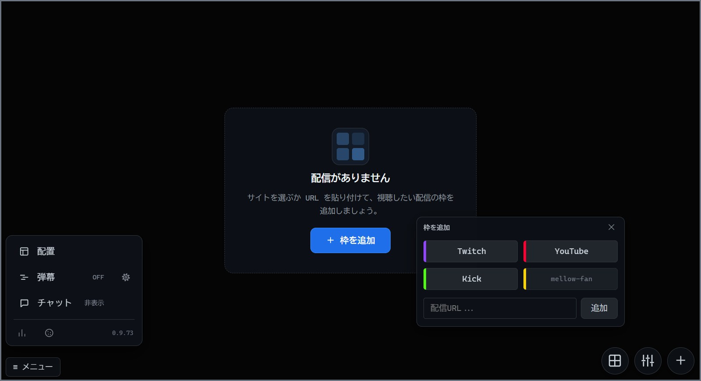
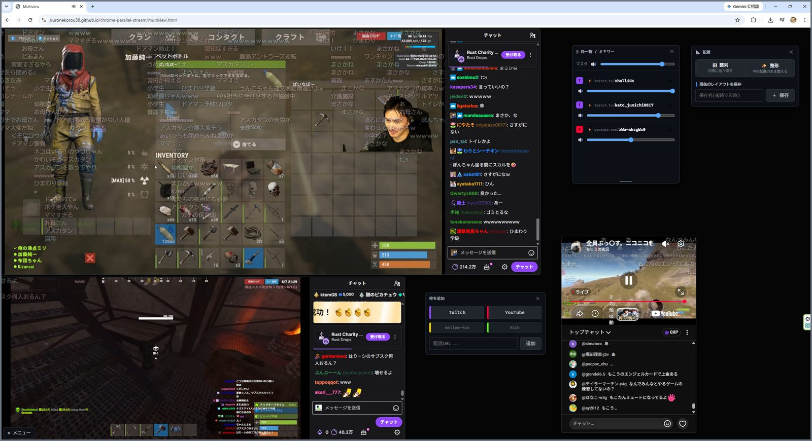
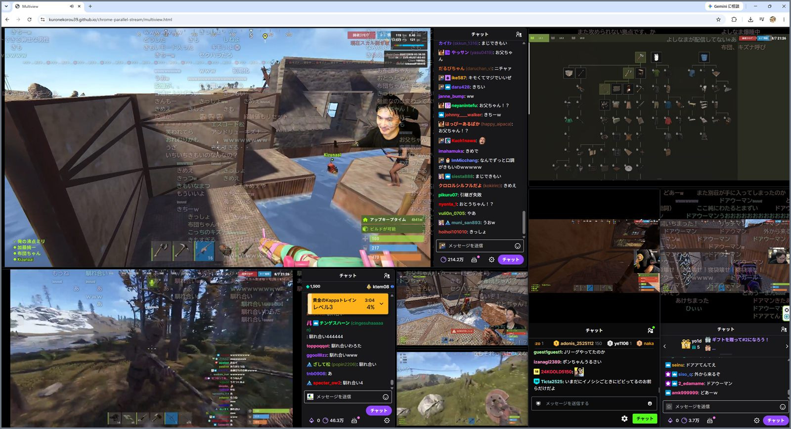
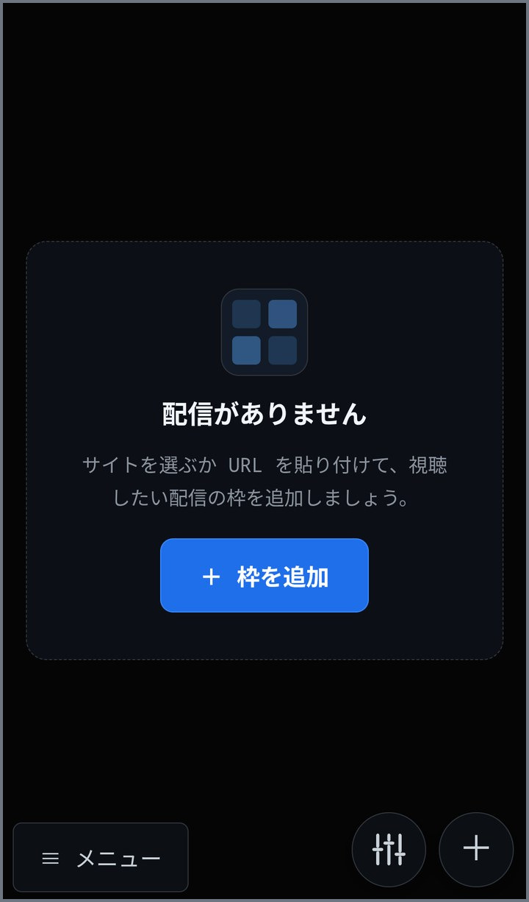
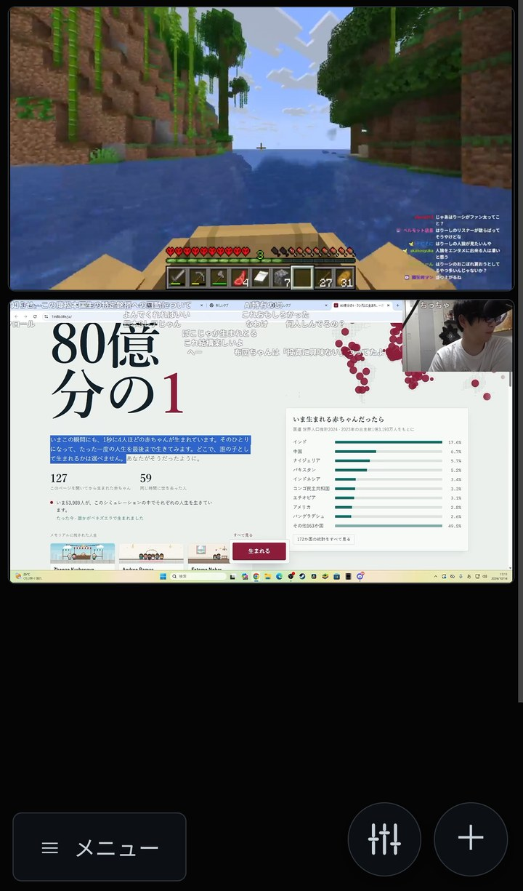

# Parallel Stream

Twitch / YouTube / mellow-fan(旧 OPENREC) / Kick の配信を、1画面に並べて同時に見るための Chrome 拡張機能です。

---

## 画面

サイトを選ぶか URL を貼って、枠を1つずつ足していきます。

| | |
| --- | --- |
|  |  |
| **枠を追加** — 右下の `＋` から、サイトのボタンか URL で | **4枠** — 枠一覧で音量、配置パネルで整列 |
|  | |
| **さらに追加** — 大きさと位置は枠ごとに自由 | |

| | |
| --- | --- |
|  |  |
| **スマホ・空の状態** | **スマホ・2枠** — Twitch と YouTube を縦に並べて再生 |

---

## できること

- 配信をいくつでも並べて、大きさと位置を自由に決める
- 枠ごとに音量を変える(全部まとめても)
- コメントを映像の上に流す(弾幕)
- 並べ方に名前を付けて保存し、あとで呼び出す
- スマホでは縦に積んで見る

---

## 広告のスキップ

広告をスキップする機能は、この拡張機能には入っていません。
別の拡張機能 **[chrome-ad-skipper](https://github.com/kuronekorou39/chrome-ad-skipper)** を一緒に入れると、並べた枠の中でも広告のスキップが効きます。

---

## インストール

1. **[ZIP をダウンロード](https://kuronekorou39.github.io/chrome-parallel-stream/dist/parallel-stream-0.9.73.zip)**して、右クリック →「すべて展開」でフォルダを取り出す
2. Chrome のアドレスバーに `chrome://extensions` と入れて開く
3. 右上の「**デベロッパー モード**」を ON にする
4. 左上に出てくる「**パッケージ化されていない拡張機能を読み込む**」を押して、1 で展開したフォルダを選ぶ
5. Chrome 右上のパズルのアイコン → **Parallel Stream** → 「**マルチビューを開く**」

これで使えます。更新するときは、新しい ZIP を落として同じ手順でフォルダを選び直してください
(アプリの `≡` メニュー →「拡張機能」から、新しい版が出ているか確認できます)。

---

## インストールする前に

配信サイトを並べるために、この拡張はブラウザに踏み込んだ変更をします。
なかでも **Cookie の変更はブラウザ全体に残ります**(設定で元に戻せます)。

何をどこまで変えるかは **[ブラウザに与える影響](docs/browser-impact.md)** に書いてあります。
**読んでから入れてください。**

---

## ライセンス

[MIT](LICENSE)

同梱しているサードパーティコードとその表示は [THIRD-PARTY-NOTICES.md](THIRD-PARTY-NOTICES.md) を参照してください。
